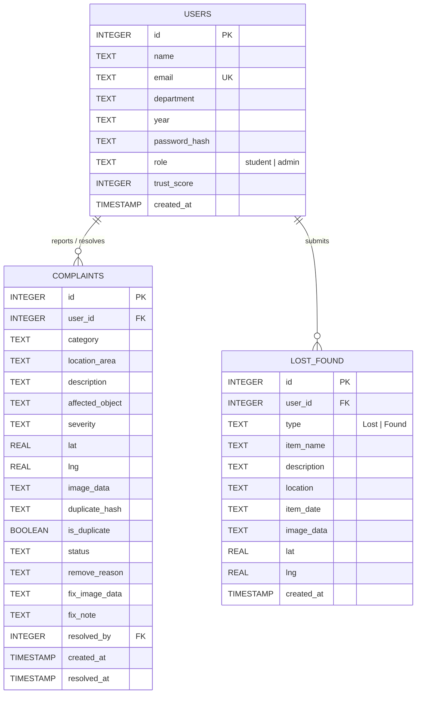

# CampusLoop: Smart Civic Complaint & Campus Management System
## Comprehensive Mini-Project Report & Feature Specification Document

---

### Table of Contents
1. [Executive Summary](#1-executive-summary)
2. [Problem Statement & Motivation](#2-problem-statement--motivation)
3. [Technology Stack & System Architecture](#3-technology-stack--system-architecture)
4. [Role-Based Access Control (RBAC)](#4-role-based-access-control-rbac)
5. [Core Features & Functional Modules](#5-core-features--functional-modules)
   - 5.1 [User Authentication & Profile Management](#51-user-authentication--profile-management)
   - 5.2 [Smart Civic Complaint Reporting](#52-smart-civic-complaint-reporting)
   - 5.3 [Dual-Layer Image Compression & Optimization Pipeline](#53-dual-layer-image-compression--optimization-pipeline)
   - 5.4 [Campus Boundary Geofencing & GPS Map Integration](#54-campus-boundary-geofencing--gps-map-integration)
   - 5.5 [Automated Duplicate Complaint Detection](#55-automated-duplicate-complaint-detection)
   - 5.6 [Dynamic Student Trust Score & Credibility Engine](#56-dynamic-student-trust-score--credibility-engine)
   - 5.7 [Admin Verification, Lifecycle Tracking & Photo Resolution](#57-admin-verification-lifecycle-tracking--photo-resolution)
   - 5.8 [Integrated Campus Lost & Found Directory](#58-integrated-campus-lost--found-directory)
   - 5.9 [Real-Time Analytics & Facilities Stat Counters](#59-real-time-analytics--facilities-stat-counters)
   - 5.10 [Multi-Criteria Filtering & Dynamic Search Feed](#510-multi-criteria-filtering--dynamic-search-feed)
6. [Database Design & Schema Architecture](#6-database-design--schema-architecture)
7. [REST API Directory & Endpoint Specifications](#7-rest-api-directory--endpoint-specifications)
8. [Security & Data Integrity Provisions](#8-security--data-integrity-provisions)
9. [UI/UX Design Philosophy & Modern Interface](#9-uiux-design-philosophy--modern-interface)
10. [Setup, Execution & Verification Instructions](#10-setup-execution--verification-instructions)
11. [Conclusion & Future Enhancements](#11-conclusion--future-enhancements)

---

## 1. Executive Summary

**CampusLoop** is a full-stack, geofenced civic problem reporting and facility maintenance platform developed for the **SIES Graduate School of Technology (SIES GST)** campus. It bridges the communication gap between students, faculty, and the college administration by providing a transparent, accountable, and tamper-resistant workflow for campus upkeep, civic problem redressal, and lost property management.

The platform eliminates traditional paper complaint registers and untracked grievance emails, introducing **live photo proof**, **interactive leaflet campus geofencing**, **perceptual SHA-256 duplicate prevention**, **dynamic student trust scoring**, and **mandatory after-repair photographic verification**.

---

## 2. Problem Statement & Motivation

### Key Challenges in Traditional Campus Maintenance:
1. **Lack of Transparency & Accountability:** When students notice broken fixtures, water leaks, or untidy areas, complaints submitted verbally or via unstructured emails get lost without progress tracking.
2. **Duplicate & Spam Submissions:** Multiple students submit identical reports for the same overflowing dustbin or pothole, overwhelming administration staff.
3. **Spurious or Non-Campus Reports:** Reports filed for locations outside campus boundaries waste administrative time and resources.
4. **Unverified Resolutions:** Grievances are frequently marked "done" in spreadsheets without physical proof that the repair was executed.
5. **Disconnected Lost & Found Management:** Lost student belongings (ID cards, calculators, water bottles) are announced on scattered WhatsApp groups with zero centralized tracking.

### CampusLoop's Solution:
A geofenced, dual-role web portal combining smart validation algorithms (client/server image compression, SHA-256 hashing, ray-casting point-in-polygon checks) with an intuitive user interface to streamline problem reporting and resolution.

---

## 3. Technology Stack & System Architecture

```
+-----------------------------------------------------------------------------------+
|                                  CLIENT LAYER                                     |
|  - HTML5 & CSS3 (Custom Design System, Glassmorphism, Theme Variables)            |
|  - Vanilla JavaScript (ES6+, Async/Await, Canvas API Image Compression)           |
|  - Leaflet.js (OpenStreetMap, Custom Boundary Polygons, Pin Dragging)             |
+-----------------------------------------------------------------------------------+
                                         |
                                (HTTP / REST APIs)
                                         v
+-----------------------------------------------------------------------------------+
|                                 BACKEND LAYER                                     |
|  - Python 3 & Flask Framework (RESTful Architecture, Session Auth)                |
|  - Flask-CORS (Cross-Origin Resource Sharing)                                     |
|  - Pillow / PIL (Server-side Image Re-compression, EXIF Orientation Normalization) |
|  - Werkzeug Security (PBKDF2 Password Hashing)                                    |
|  - Mathematical Ray-Casting Polygon Geofencing Module                             |
+-----------------------------------------------------------------------------------+
                                         |
                                (SQL Queries / ACID)
                                         v
+-----------------------------------------------------------------------------------+
|                                 DATABASE LAYER                                    |
|  - SQLite3 Relational Database                                                    |
|  - Relational Schema with Foreign Keys & Constraint Checks                        |
+-----------------------------------------------------------------------------------+
```

- **Frontend:** Pure Vanilla HTML5, Vanilla CSS3 (without heavy UI framework overhead), Modern ES6+ JavaScript, Leaflet.js OpenStreetMap tiles.
- **Backend:** Python 3, Flask microframework, Werkzeug security utilities.
- **Image Processing:** HTML5 2D Canvas API (Browser) + Pillow / PIL (Server).
- **Database:** SQLite 3 with transactional integrity and foreign key constraints.

---

## 4. Role-Based Access Control (RBAC)

The application enforces strict role segregation:

| Capability / Action | Student Role | Administrator Role |
| :--- | :---: | :---: |
| Account Registration & Login | Yes (College Email Domain) | Yes (Admin Console tab) |
| Submit Maintenance Report (with photo) | Yes | Yes |
| Edit Pending Report Details | Yes (Only own `SUBMITTED` reports) | No (Admin verifies/resolves) |
| Reopen Inadequately Fixed Report | Yes (Own reports only) | No |
| Post Lost / Found Item | Yes | Yes |
| View Campus Complaints Feed & Photo Proofs | Yes (Anonymized reporter info) | Yes (Full student audit details) |
| Inspect Reporter Trust Score, Email & Dept | No (Hidden for student privacy) | Yes (Full transparency) |
| Advance Status (`SUBMITTED` -> `VERIFIED` -> `IN_PROGRESS`) | No | Yes |
| Resolve Complaint with After-Fix Photo Proof | No | Yes (Mandatory image upload) |
| Remove / Archive Spam Complaint | No | Yes (Reason & optional penalty) |

---

## 5. Core Features & Functional Modules

### 5.1 User Authentication & Profile Management
- **Domain-Specific Registration:** Students sign up with Name, College Email (`@siesgst.edu.in`), Academic Department (Computer, AIDS, IT, EXTC, ECS, Mechanical, Humanities), Academic Year (FE, SE, TE, BE), and secure password.
- **Password Complexity Engine:** Requires 8+ characters, lowercase, uppercase, numeric digit, and special symbol.
- **Cryptographic Password Storage:** Passwords hashed using PBKDF2 with SHA-256 via Werkzeug.
- **Session-Based Cookie Authentication:** Secure session management preventing unauthorized API access (`/api/me`).
- **Pre-Seeded Default Admin Account:** Auto-bootstrapped on database initialization (`admin@siesgst.edu.in`).

### 5.2 Smart Civic Complaint Reporting
- Structured complaint capture form covering:
  - **Category:** Garbage & Waste, Water Leakage, Electrical Issue, Broken Infrastructure, Road / Pothole, Washroom Issue, Cleanliness, Safety Issue, Other.
  - **Location & Landmark:** Area name (e.g., *2nd Floor Water Cooler, GST Quadrangle, Canteen Entrance*).
  - **Affected Object:** Pinpointing exact apparatus (e.g., *Main ceiling fan, Switchboard 3B*).
  - **Severity Rating:** 🟢 Low, 🟡 Medium, 🟠 High, 🔴 Critical.
  - **Problem Description:** Comprehensive description text.
  - **Live Photo Proof:** Mandatory photo upload or mobile camera capture (`capture="environment"`).
  - **Geolocation Coordinates:** Optional or automated GPS latitude/longitude.

### 5.3 Dual-Layer Image Compression & Optimization Pipeline
To prevent slow mobile uploads and database bloating without compromising evidentiary clarity:
1. **Client-Side (Canvas API):**
   - Rescales high-resolution photos (from 12MP/48MP smartphone cameras) to maximum dimension of 1600px maintaining exact aspect ratio.
   - Converts to optimized JPEG (~84% quality).
   - Real-time compression telemetry pill shows file size saved (e.g., *"Compressed: 320 KB (was 3.8 MB, 92% saved)"*).
2. **Server-Side Fallback (Pillow / PIL):**
   - Automatically inspects and transposes EXIF orientation metadata so smartphone photos never appear sideways or inverted.
   - Downsamples image buffer with `Image.Resampling.LANCZOS`.
   - Iteratively compresses high-resolution uploads down to safe storage threshold (< 1 MB).

### 5.4 Campus Boundary Geofencing & GPS Map Integration
- **Mathematical Geofencing:** Implements the **Ray-Casting Point-in-Polygon Algorithm** (`is_point_in_polygon`).
- **SIES GST Coordinates Polygon:** Defined boundary vertices enclosing the Nerul campus:
  ```python
  SIES_GST_BOUNDARY = [
      (19.0447, 73.0227),
      (19.0449, 73.0244),
      (19.0423, 73.0244),
      (19.0421, 73.0227)
  ]
  ```
- **Leaflet.js Interactive Map:**
  - Visual green polygon overlay displaying the official SIES educational complex boundary.
  - Quick-jump landmark pills (*🎓 GST Engg, 💼 MBA Wing, 📚 Commerce & Arts, 🛕 Ayyappa Temple*).
  - Real-time draggable pin with immediate boundary validation warning if placed outside campus.
  - "Use My Current Location" button leveraging the browser Geolocation API (`navigator.geolocation`).

### 5.5 Automated Duplicate Complaint Detection
- **Image Hashing:** During ingestion, the compressed image bytes are hashed using **SHA-256** to generate a unique perceptual fingerprint (`duplicate_hash`).
- **Duplicate Prevention:** Queries existing active complaints for matching hashes. If an identical photo is submitted for an existing pending issue, submission is cleanly blocked with a clear warning:
  > *"This image appears to have already been submitted."*
- Excludes archived/removed complaints from collision checking so resolved or false entries don't permanently lock genuine re-reports.

### 5.6 Dynamic Student Trust Score & Credibility Engine
- **Initial Score:** Users begin with a baseline credibility score (50–100).
- **Reward for Constructive Civic Participation:** When an administrator verifies and resolves a student's complaint, the student receives **+5 Trust Score points** (capped at 100).
- **Spam Penalty Mechanism:** If a user submits malicious, abusive, or fake complaints, the administrator can apply an immediate **-10 Trust Score penalty**.
- **Admin Visibility:** Administrators see color-coded trust score badges next to reporter names:
  - 🟢 70–100: Trusted Volunteer
  - 🟡 40–69: Moderate Trust
  - 🔴 < 40: High Risk / Watchlist Reporter

### 5.7 Admin Verification, Lifecycle Tracking & Photo Resolution
Complaints transition through a rigorous status lifecycle:
```
[SUBMITTED]  ───>  [VERIFIED]  ───>  [IN_PROGRESS]  ───>  [RESOLVED]
     │                                                        │
     ├───> [REMOVED / SPAM]                                   └───> [REOPENED] (by student)
```
- **Status Advancement:** Admin one-click dropdown directly updates status to acknowledge receipt.
- **Mandatory After-Repair Photo Proof:** An issue cannot be marked `RESOLVED` without uploading proof photo of the completed cleaning/repair and resolution note (`fix_image_data` and `fix_note`).
- **Student Reopen Option:** If a problem was marked resolved prematurely, the original reporting student can click **"Still Exists / Reopen"**, setting status to `REOPENED` for admin re-inspection.

### 5.8 Integrated Campus Lost & Found Directory
- Two-step intuitive wizard:
  - **Step 1:** Big, tactile action selection (**🔴 Lost Item** vs **🟢 Found Item**).
  - **Step 2:** Form collecting Item Name, Category, Date of incident, Location found/lost, Detailed identifying marks, Photo proof, and Map coordinates.
- Separate dedicated Lost & Found feed with real-time status pills (*Lost* / *Found*), reporter contact details, and lightbox photo preview.

### 5.9 Real-Time Analytics & Facilities Stat Counters
- Header counter cards compute live metrics from the SQLite database:
  - **Total Reports:** All historical campus tickets.
  - **Pending Action:** Active issues requiring administration review.
  - **Resolved Issues:** Cleared maintenance tasks backed by photo proof.
- Pill counter badges display exact tallies for each sub-category (*Pending Review*, *In Progress*, *Resolved with Proof*, *Removed / Spam*).

### 5.10 Multi-Criteria Filtering & Dynamic Search Feed
- **Instant Search:** Client-side debounced text search filtering across category, description, area, object, and reporter details.
- **Status Pills Filter:** Instant toggling between *All*, *Pending Review*, *In Progress*, *Resolved with Proof*, and *Removed/Spam*.
- **Category Filter Dropdown:** Filter by specific maintenance domain (e.g., only *Electrical* or only *Washroom*).
- **Interactive Lightbox Modal:** Clicking any before/after photo opens a full-screen high-definition lightbox.

---

## 6. Database Design & Schema Architecture

The database is built on SQLite3 and enforces relational consistency, auto-incrementing primary keys, and foreign key cascades.



---

## 7. REST API Directory & Endpoint Specifications

| Method | Endpoint | Access Level | Description |
| :--- | :--- | :--- | :--- |
| `POST` | `/api/register` | Public | Registers a new student account with validation |
| `POST` | `/api/login` | Public | Authenticates credentials and starts user session |
| `GET` | `/api/me` | Authenticated | Fetches current logged-in user profile & role |
| `POST` | `/api/logout` | Authenticated | Clears current user session cookies |
| `GET` | `/api/stats` | Authenticated | Retrieves campus totals: Total, Pending, Resolved |
| `GET` | `/api/complaints` | Authenticated | Lists all civic issues (admin gets full user metadata) |
| `POST` | `/api/complaints` | Authenticated | Submits new complaint with compression & duplicate check |
| `POST` | `/api/complaints/<id>/edit` | Student (Owner) | Edits report before admin verification |
| `POST` | `/api/complaints/<id>/status` | Admin Only | Updates lifecycle status (`VERIFIED`, `IN_PROGRESS`) |
| `POST` | `/api/complaints/<id>/resolve` | Admin Only | Resolves issue with mandatory fix photo & notes |
| `POST` | `/api/complaints/<id>/remove` | Admin Only | Removes complaint with optional trust penalty |
| `POST` | `/api/complaints/<id>/still_exists` | Student (Owner) | Reopens unresolved report |
| `GET` | `/api/lost_found` | Authenticated | Lists all lost and found item notices |
| `POST` | `/api/lost_found` | Authenticated | Posts a new lost or found notice |

---

## 8. Security & Data Integrity Provisions

1. **Authentication Guard:** Frontend redirects unauthenticated users automatically via session checks (`/api/me`).
2. **SQL Injection Prevention:** 100% of SQLite database queries execute via parameterized queries (`?` placeholders).
3. **Role Segregation & Authorization:** Endpoints like `/resolve`, `/remove`, and `/status` verify session role strictly on the server:
   ```python
   if not user_id or role != "admin":
       return jsonify({"error": "Admin access required."}), 403
   ```
4. **Ownership Verification:** Students can only edit or reopen tickets that match their own `session["user_id"]`.
5. **No Stale HTTP Cache Headers:** Every API response attaches `Cache-Control: no-store, no-cache, must-revalidate` to prevent stale data leaks across public workstations.
6. **Input Sanitization & Constraints:** Form inputs are trimmed, sanitized, and constrained by database `CHECK` conditions.

---

## 9. UI/UX Design Philosophy & Modern Interface

- **Color Palette & Visual Identity:**
  - Deep Emerald Navy (`#022C22`) and Forest Green (`#047857`) representing campus environmental cleanliness.
  - Vibrant Emerald Accent (`#10B981`) for actionable elements and primary CTAs.
  - Warm Parchment (`#F9F6EE`) and Card White (`#FFFFFF`) for readable document hierarchy.
  - High-visibility Status Hues: Amber Warning (`#D97706`), Crimson Danger (`#EF4444`), Sky Info (`#0284C7`).
- **Typography:** Google Fonts pairing of **Fraunces** (editorial serif for titles and statistics) and **Manrope** (clean, ergonomic sans-serif for UI forms and data tables).
- **Micro-Interactions & Modals:**
  - Glassmorphic backdrop filters (`backdrop-filter: blur(8px)`).
  - Floating status pills and responsive card hover states.
  - Full keyboard accessibility with Escape key modal dismissals and backdrop dismissals.

---

## 10. Setup, Execution & Verification Instructions

### 10.1 Prerequisites
- Python 3.8+ installed on system.
- Modern Web Browser (Google Chrome, Microsoft Edge, Firefox, Safari).

### 10.2 Installation & Server Launch
```bash
# 1. Open project directory in terminal
cd "Smart-Civic-Complain"

# 2. Install dependencies
pip install -r backend/requirements.txt

# 3. Start the Flask application
python backend/app.py
# (Or on Windows with Python launcher):
# py -3.8 backend/app.py
```

### 10.3 Accessing the Application
- Open browser at: **`http://localhost:5000`**
- **Default Administrator Credentials:**
  - Email: `admin@siesgst.edu.in`
  - Password: `Admin@123`

---

## 11. Conclusion & Future Enhancements

**CampusLoop** successfully demonstrates how contemporary web technologies can modernize campus civic management. By combining client-side optimization with server-side geofencing, duplicate hashing, and photographic verification, it delivers an accountability-driven solution suited for academic institutions.

### Roadmap for Future Work:
- **Push & WhatsApp Notifications:** Automated updates alerting students when their complaint is marked in-progress or resolved.
- **AI-Powered Visual Categorization:** Computer Vision model (e.g., MobileNet/YOLO) to automatically recognize waste types and severity from the uploaded photo.
- **Maintenance Staff Worker Portal:** Dedicated mobile-first view for janitorial and electrician contractors to receive task assignments and upload resolution selfies on site.
- **Automated Service Level Agreements (SLAs):** Escalation alerts if a high-severity report remains unaddressed after 48 hours.

---
*Report generated for SIES GST Semester 3 Mini-Project Documentation • CampusLoop Team*
